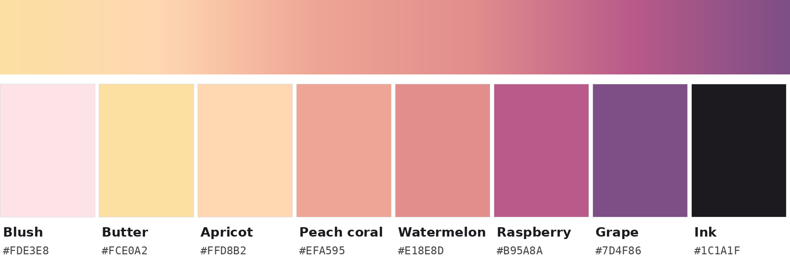

# Candy Cloud (reference palette)

Taken from the packaging of **Phil & Sebastian, Candy Cloud Espresso**: a soft sunset gradient that runs
from blush and butter, through peach and watermelon, down to raspberry and grape, with black type.
This is filed for reference only. Kiln does not use it (the app's design is Signal in Miami Heat).

| Name | Hex | Role on the bag |
|---|---|---|
| Blush | `#FDE3E8` | Main background, the pale pink upper half |
| Butter | `#FCE0A2` | Yellow highlight in the top wave |
| Apricot | `#FFD8B2` | Light orange body of the top wave |
| Peach coral | `#EFA595` | Middle wave |
| Watermelon | `#E18E8D` | Pink where the waves meet |
| Raspberry | `#B95A8A` | Deep pink of the lower wave |
| Grape | `#7D4F86` | Purple base band |
| Ink | `#1C1A1F` | Logo and all text |

## Notes
- **How the colours were taken:** sampled from a phone photo shot under warm indoor light, then
  white-balanced against the bag's white label. They match the print closely but not exactly; the grape
  band was in shadow, so it may print a touch brighter.
- **Contrast:** all colours from Blush to Watermelon are pastels, so text on them must be Ink.
  - Ink on them ranges from 6.9:1 (Watermelon) to 14.2:1 (Blush).
  - Grape takes white text (6.3:1).
  - Raspberry is borderline either way: white is 4.3:1 and Ink is 4.0:1. Use it for large text,
    shapes and backgrounds, not small body text.
- **The look:** much of the bag's softness comes from fine wavy contour lines over the gradient.
